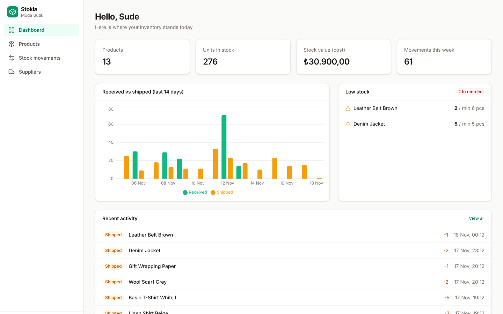
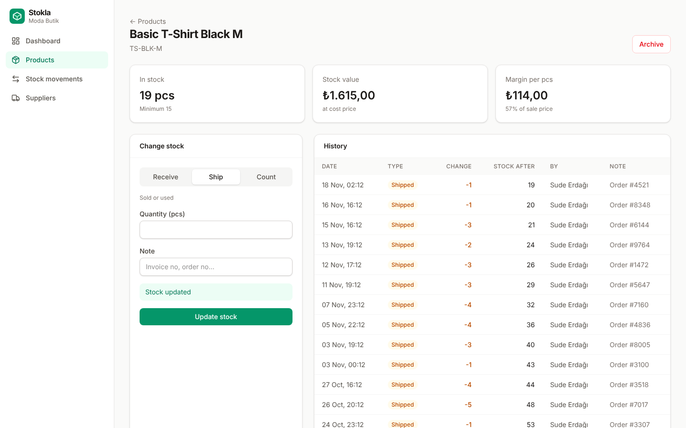
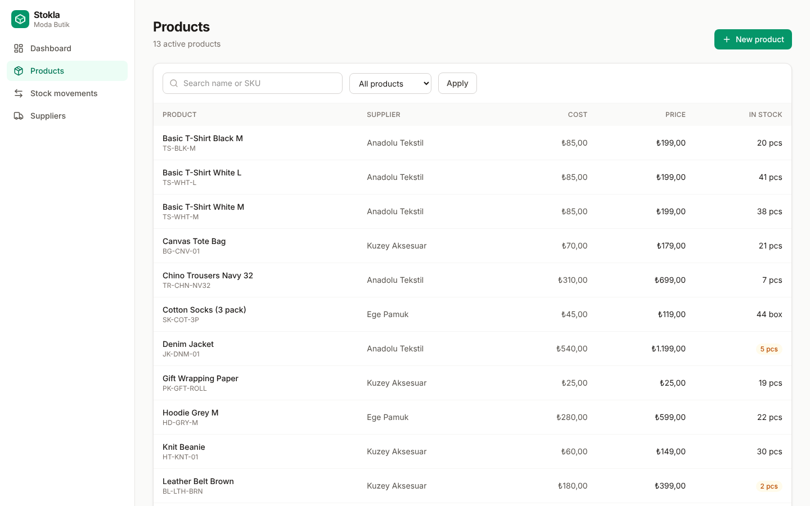

# Stokla

Inventory management for small businesses. A shop owner signs up, adds products and suppliers, and records every item that comes in or goes out. Stokla keeps the stock levels, shows what the stock is worth and warns before best sellers run out.

**Live demo:** https://stokla-sage.vercel.app (sign in with `demo@stokla.dev` / `demo1234`)



## Features

- **Accounts and businesses:** signing up creates a business (organization); all data is scoped to it
- **Products:** SKU, unit, cost and sale price, minimum stock level, supplier
- **Stock movements:** receive goods, ship goods, or set the stock to a counted number after a stocktake; every change is logged with the user, a note and the resulting stock level
- **Dashboard:** number of products, units and stock value, received vs shipped chart for the last 14 days, low stock list, recent activity
- **Suppliers** and supplier-product links
- **Search and filters** that live in the URL and work without JavaScript

| Product page | Products |
| --- | --- |
|  |  |

## Tech stack

- **Next.js 15 (App Router)** with React Server Components and **Server Actions** for all mutations, no separate REST layer
- **PostgreSQL + Prisma** for the schema, migrations and queries
- **Custom session auth:** bcrypt password hashes, random session tokens stored as SHA-256 hashes, httpOnly cookies
- **Zod** validation on every form, with field errors shown via `useActionState`
- **Tailwind CSS 4**, Recharts, lucide icons
- **Vitest** tests against a real database, GitHub Actions CI

## How it works

### Multi-tenancy

Every table (products, suppliers, movements) has an `organizationId`. Pages and actions read the organization from the session, never from the request, and every query filters by it. Reads use `findFirst({ where: { id, organizationId } })` and writes use `updateMany` with the same filter, so guessing another business's product ID gives a 404 instead of its data. A test checks that one organization cannot change another's stock.

### Stock that never goes negative

Product quantities are only changed by `recordMovement()` in [`src/lib/stock.ts`](src/lib/stock.ts), inside a transaction that also writes the movement log. Selling uses a single conditional update:

```ts
await tx.product.updateMany({
  where: { id, quantity: { gte: amount } },   // only if enough stock is left
  data: { quantity: { decrement: amount } },
})
```

If two people sell the last item at the same moment, PostgreSQL applies the updates one after the other and the second one matches no rows, so the stock can't drop below zero. A test fires 10 parallel sales against 5 units and checks that exactly 5 succeed.

Stock counts ("I counted 7, the system says 10") use optimistic locking: the adjustment is only applied if the quantity hasn't changed since it was read.

Because every change goes through the log, `product.quantity` always equals the sum of its movements, and each movement stores the stock level right after it, so the history reads like a bank statement.

### Sessions

Login creates a 32-byte random token. The browser gets it in an httpOnly, SameSite cookie; the database only stores its SHA-256 hash, so a leaked sessions table can't be used to log in. The middleware does a fast cookie check, and `getCurrentUser()` validates the session against the database (cached per request with React `cache()`).

## Project structure

```
prisma/
├── schema.prisma
├── migrations/
└── seed.ts                  # demo business with 30 days of history
src/
├── middleware.ts            # redirects signed-out users to /login
├── app/
│   ├── page.tsx             # landing page
│   ├── (auth)/              # login, register + their server actions
│   └── (app)/               # signed-in area: dashboard, products, movements, suppliers
├── components/              # form fields, cards, badges
└── lib/
    ├── stock.ts             # stock movements and inventory numbers
    ├── session.ts           # session cookies
    ├── validation.ts        # Zod schemas
    └── db.ts
tests/                       # Vitest tests against PostgreSQL
```

## Running locally

```bash
docker compose up -d          # or use your own PostgreSQL
cp .env.example .env
npm install
npm run db:migrate
npm run db:seed               # optional: demo@stokla.dev / demo1234
npm run dev                   # http://localhost:3000
```

## Tests

```bash
npm test
```

Tests run against a separate database (`TEST_DATABASE_URL`, default `stokla_test`): stock movements, concurrency, stock counts, organization isolation, dashboard numbers and form validation. Because the tests delete all data, they refuse to start unless the database name contains `test`.

## Deploying

The app runs on any Node.js host. On Vercel: create a PostgreSQL database (Neon, Supabase or Vercel Postgres), set `DATABASE_URL`, and use `prisma migrate deploy && next build` as the build command.

## Possible next steps

- Invite staff members to an organization (the `STAFF` role already exists in the schema)
- Purchase orders that create "receive" movements when goods arrive
- Barcode scanning on mobile
